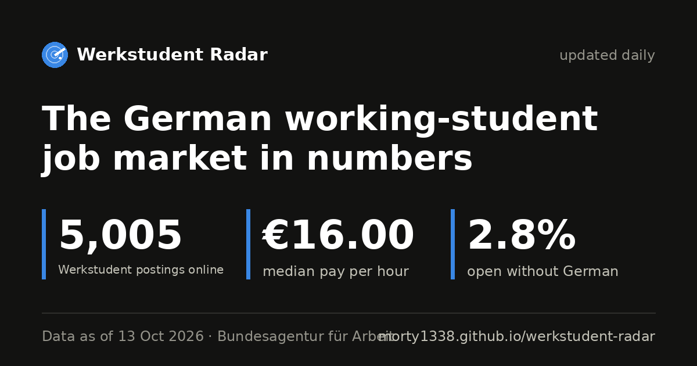
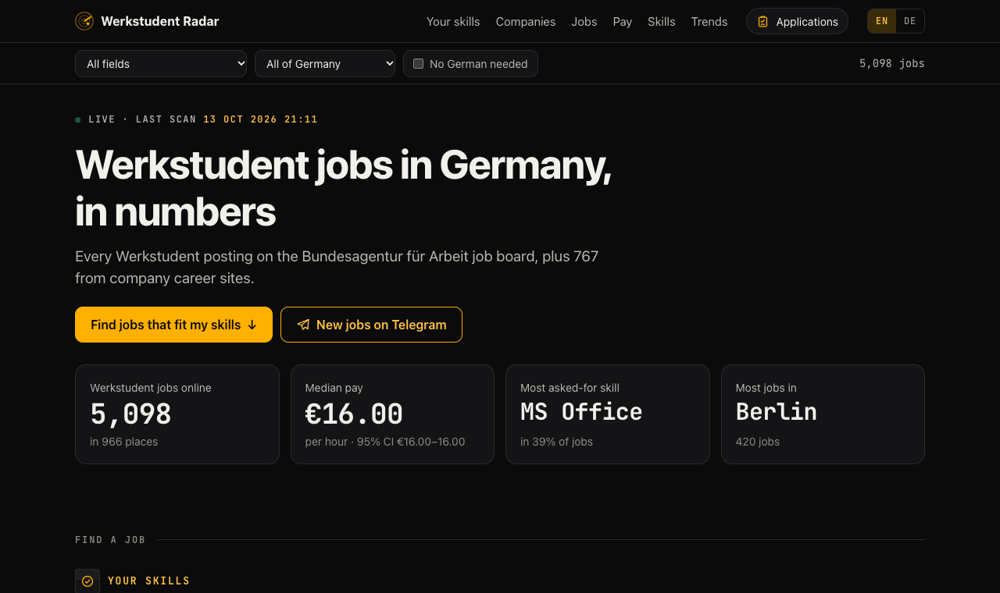
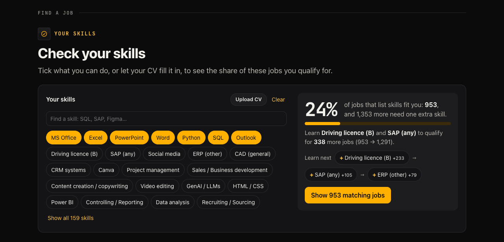
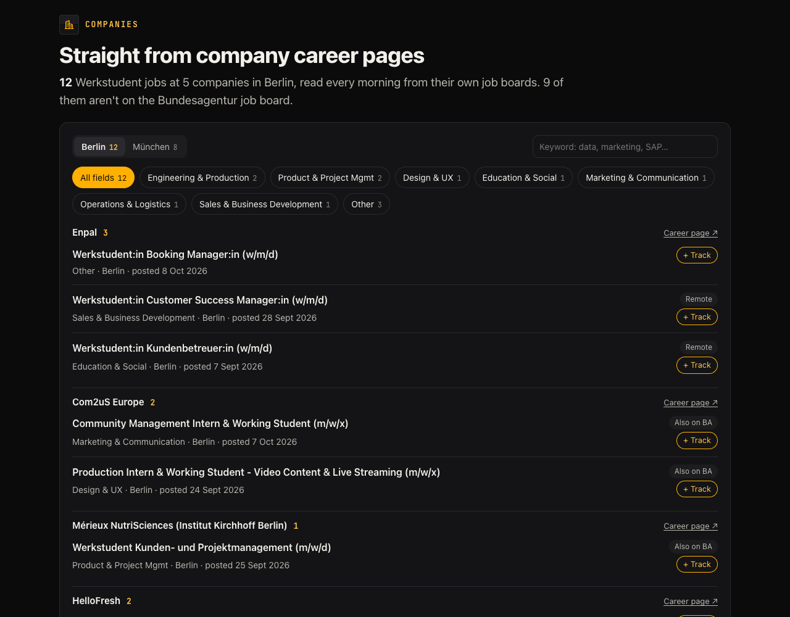
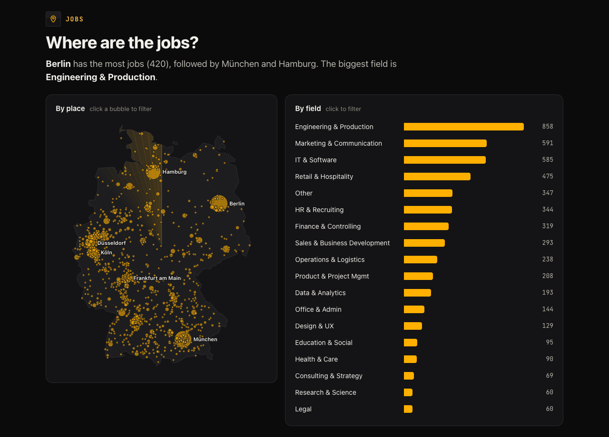
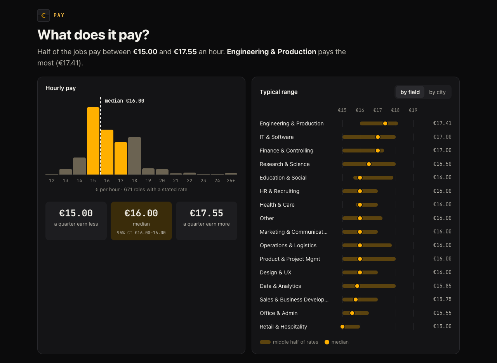
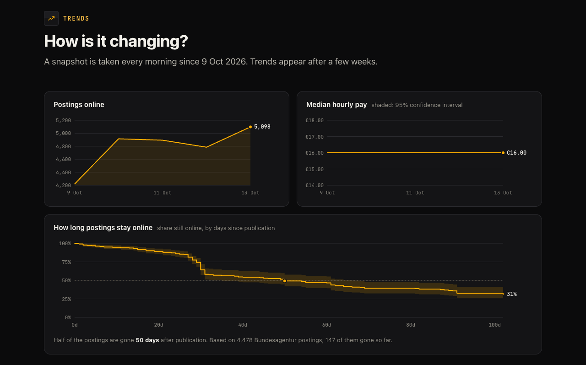
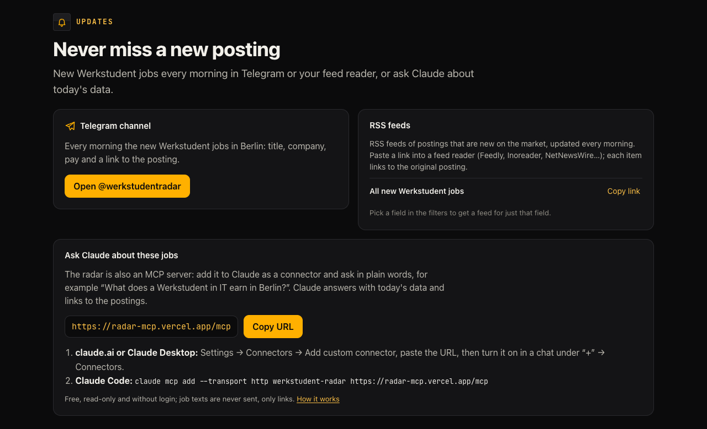
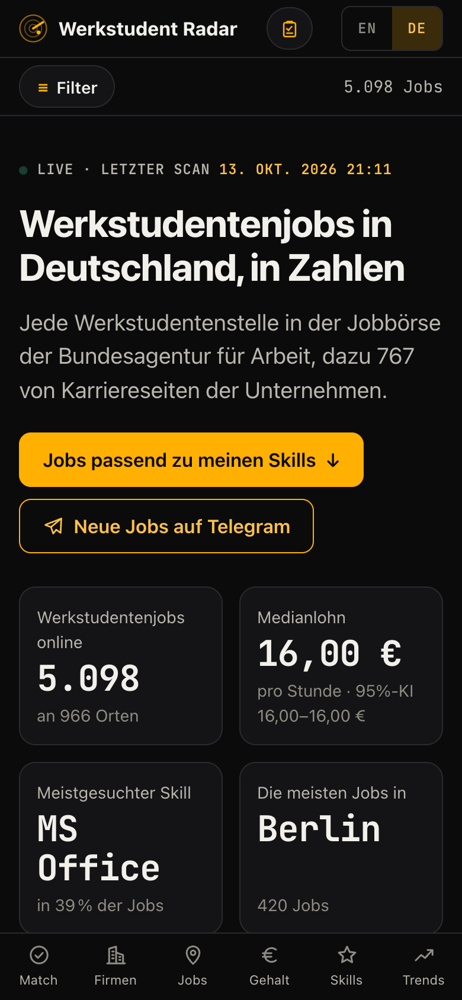
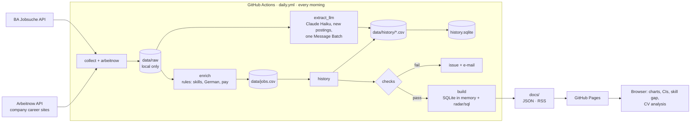

# Werkstudent Radar

[](https://github.com/morty1338/werkstudent-radar/actions/workflows/daily.yml)
[](https://github.com/morty1338/werkstudent-radar/actions/workflows/tests.yml)
[](https://github.com/morty1338/werkstudent-radar/actions/workflows/lighthouse.yml)

[](https://morty1338.github.io/werkstudent-radar/)

The German working-student job market in numbers: real hourly rates, which
skills are in demand, and how many jobs you can get without speaking German.

Only Werkstudent postings in Germany are collected, from two sources:

- the public job search of the [Bundesagentur für Arbeit](https://www.arbeitsagentur.de/jobsuche/), and
- companies' own career sites (Personio, Greenhouse, Lever, …) through the free
  [Arbeitnow](https://www.arbeitnow.com/) job API. This adds many start-ups that
  never post on the Bundesagentur's board. A posting on both counts once.

LinkedIn, StepStone and Indeed forbid automated collection (terms of use,
`robots.txt`, EU database rights), so they aren't used; most of their postings
are copied from the same company career sites.

**Live: [morty1338.github.io/werkstudent-radar](https://morty1338.github.io/werkstudent-radar/)**, updated every morning.

The page answers one question per section, and every chart is a filter: click
Berlin on the map or "IT & Software" in a chart and the whole page follows.

1. **Where are the jobs?** A map of ~940 places on Germany's outline, with a slow
   radar sweep, and the job fields.
2. **What does it pay?** The hourly pay distribution and the typical range per
   field or city; every median with its 95% confidence interval.
3. **Which skills are asked for?** The most requested skills by group; click one
   for its pay, where it's used, and its jobs.
4. **How is it changing?** Daily snapshots from 9 Oct 2026 on, and how long
   postings stay online (Kaplan–Meier).
5. **Check your skills.** Tick skills, or upload a CV (PDF, DOCX or TXT) and its
   skills are ticked for you, to see the share of jobs you qualify for, what to
   learn next and the matching postings. The CV is analysed in the browser with
   the same skill dictionary as the postings and is never uploaded.
6. **Straight from company career pages.** Werkstudent jobs in Berlin and
   München read every morning from the job boards of a list of companies,
   grouped by company, with a city switch, field and keyword filters, "new
   today" and "also on BA" marks, and links to the original postings.

In German or English (switch in the header), on phones with a bottom tab bar,
and installable as a home-screen app. RSS feeds announce new postings per field.

**Applications** (the button in the header) keeps track of your own applications:
press "+ Track" on any job on the page or add one found elsewhere, then move it from
saved to applied, interview, offer or rejection (each step dated), add a note and a
follow-up date. Postings that leave the daily data are marked "no longer online".
The list stays in your browser and is never sent anywhere; an export file is the
backup.

## Screenshots

| Start: today's numbers and the two main actions | Check your skills and what to learn next |
|---|---|
|  |  |
| **Jobs straight from company career pages** | **Where the jobs are** |
|  |  |
| **Pay with confidence intervals** | **How long postings stay online** |
|  |  |



<p align="center"></p>

## Key numbers

As of 13 Oct 2026 (the live site updates every morning):

| | |
|---|---|
| Postings online | **5,032** (Bundesagentur 4,287, company career sites 745) from 2,638 employers in 965 places |
| Postings tracked since the start | 5,296 |
| Days of history | 5 (daily since 9 Oct 2026), with online stretches per posting |
| Median hourly pay | **€16.00** (95% CI €16.00–16.00; 665 roles with a stated rate) |
| Company career pages | 20 Werkstudent jobs in Berlin and München from 15 company job boards, 7 of them also on the Bundesagentur |
| Skill detection, 14 common skills | precision **99%**, recall **97%** on the random 70 labelled postings (before rule fixes: 99% / 96%) |
| Skills read by Claude Haiku | F1 **96%** vs. 95% for the rules on all 100 labelled postings (17 skills), plus must have / nice to have; about **$0.22 per 1,000 postings** by Message Batch |
| German requirement | right level in 69 of 70 random postings; "open without German" correct 15/15 |
| Tests | 506 (pytest, incl. Node checks for the browser code, the MCP server over HTTP and the LLM step with a stand-in API) |
| Lighthouse (desktop) | 100 / 100 / 100 / 100 |

## Architecture



Everything runs on free tiers: GitHub Actions for the pipeline, GitHub Pages for
the site. No server, no database server, no secrets. Job texts stay on the
machine that fetched them; only extracted features and aggregates are published.

## Quick start

```bash
python3 -m venv .venv
.venv/bin/pip install -r requirements.txt
.venv/bin/python -m radar.collect   # 1. raw search results (~30 s)
.venv/bin/python -m radar.arbeitnow # 1b. company career sites (a few minutes, paced)
.venv/bin/python -m radar.enrich    # 2. job texts -> features in data/jobs.csv (~2 min on the first run)
.venv/bin/python -m radar.history   # 3. today's scan -> data/history/*.csv, data/history.sqlite
.venv/bin/python -m radar.checks    #    data-quality checks (exit code 1 if one fails)
.venv/bin/python -m radar.build     # 4. SQL aggregates -> docs/data/*.json + data/history.csv
```

`collect` pages through the job search API for all Werkstudent postings in Germany
and writes them to `data/raw/<date>/`:

| File | Content |
|------|---------|
| `listings.jsonl.gz` | one raw search result per line, de-duplicated by reference number |
| `run.json` | run metadata: endpoint, results per query, counts, duration |

`enrich` fetches the full text only for postings that are new (or were tagged
by an older rule version), caches it locally in `details.jsonl.gz` and turns
it into features. Raw data stays local (`data/raw/` is git-ignored). Job
descriptions belong to the employers and are never published: `data/jobs.csv`
holds only derived features plus the reference number, which links to the
original posting at `https://www.arbeitsagentur.de/jobsuche/jobdetail/<refnr>`.

## `data/jobs.csv`

One row per Werkstudent posting ever seen.

| Column | Meaning |
|--------|---------|
| `refnr`, `title`, `company`, `hauptberuf` | posting metadata from the API |
| `city`, `region`, `lat`, `lon` | first location: city name normalised, coordinates for the map |
| `category` | job field from title / occupation (`it`, `data`, `marketing`, `finance`, `engineering`, `retail`, …) |
| `lang` | language the posting is written in (`de` / `en`) |
| `german` | `required` (e.g. "fließend Deutsch", "German C1"), `plus` ("von Vorteil", "nice to have"), `none` ("English only", or an English posting that never asks for German), `implicit` (German posting that doesn't mention it) |
| `english` | 1 if English is required |
| `pay_min`, `pay_max`, `pay_src` | hourly pay in € from the API's salary fields (`ba`) or the text (`text`, e.g. "17,50 € brutto pro Stunde") |
| `hours` | hours per week, if stated |
| `skills` | skill ids from [`radar/skills.py`](radar/skills.py), `\|`-separated |
| `majors` | study programmes mentioned (`wiinf`, `inf`, `bwl`, `wiing`, …) |
| `remote`, `external` | home office possible; posting links to an external site |
| `published`, `first_seen`, `last_seen` | first publication date; first/last day the collector saw it |
| `detail_ok`, `xv` | text was available; extractor version used |
| `source`, `url` | `ba` or `arbeitnow`; link to the original (empty for `ba`, which links via `refnr`) |

### How features are extracted

- **Skills**: a dictionary of ~180 skills with German and English synonyms
  (`SQL`, `Power BI`, `SAP FI/CO`, `Buchhaltung`/`accounting`, …). Words that
  are also common language ("Excel" vs. "excel at", "React" vs. "react to")
  are matched case-sensitively. Broad domain terms ("Einkauf", "Vertrieb",
  "Recruiting") only count next to a requirement cue like "Kenntnisse",
  "Erfahrung" or "experience", so benefits such as "5% Einkaufsrabatt" or an
  "Recruiting-Team" contact line don't count.
- **German**: regex rules for requirement phrases, scoped to the list item they
  appear in, so in "Sehr gute Deutschkenntnisse, Englisch von Vorteil" the
  "von Vorteil" is attributed to English.
- **Pay**: an amount only counts as hourly pay when the marker sits right next
  to it ("16 €/h", "Stundenlohn von 16 €"), and only between 12 and 60 €.

### Skills by Claude Haiku (`radar/llm.py`, `radar/extract_llm.py`)

Where a posting has task and requirement sections ("Deine Aufgaben", "Dein
Profil", "Das bringst du mit", "Von Vorteil", found by heading rules), only
those go to `claude-haiku-5-5`, with single lines about pay or hours. The model
answers in a strict JSON schema (structured outputs): each skill with the
posting's own term, an id from the skill list (or "other"), and must have or
nice to have; German and English level; hourly pay; weekly hours. The
instructions and the skill list are one cached system prompt, so after the
first request of a run they cost a tenth of the input price. Thinking runs at
effort `low` (2 points more F1 than without, for about a quarter more cost).

Every answer is checked again: an id is kept only when the term fits it (the
rules' pattern for that skill or a word of its label), else it goes to the
listed skill that fits or to "other"; this stops the model from filing
"Präsentationen" under PowerPoint. Each skill also comes with a short verbatim
quote (`evidence`), checked against the text that was sent; the quotes are used
for checks only and never stored in the repository. Postings without such
headings (about one in six) are sent whole. The daily run sends only postings
whose text (title + text, hashed) has no result yet, as one Message Batch at
half price; an active Bundesagentur posting without a result whose text this
run doesn't have (fetched by an earlier run elsewhere) is fetched once, up to
300 per run. A batch
that isn't done in 20 minutes is collected by the next run, and without the API
key or on any API error the rules' results stand. Results:
`data/history/llm.csv`; per run tokens, cost and the agreement with the rules:
`data/history/llm_runs.csv`. The site's skill statistics use the LLM's skills
where they exist and the rules' otherwise; German and pay still come from the
rules. Basics that most office jobs ask for (MS Office, Excel, PowerPoint,
Word, driving licence; `BASIC_SKILLS` in `radar/skills.py`) are shown in their
own row under the specific skills: MS Office is a real requirement in most IT
postings too (a check of 40 sampled IT postings with the evidence quotes found
37 asked of the candidate, 3 borderline IT-support cases, none from "tools we
offer"), but it says little about a job. The MCP tool `top_skills` has
`exclude_basics` for the same view.

## Aggregation (`radar/build.py`, `radar/sql/`)

`build` loads `jobs.csv` into an in-memory SQLite database
([schema](radar/sql/schema.sql): `jobs`, link tables `job_skills` /
`job_majors`, label tables) and runs one SQL file per output. Medians and
quartiles come from a custom `percentile(value, q)` aggregate, their confidence
intervals from a `median_ci(value, bound)` aggregate; top-N per group uses
window functions. The statistics live in [`radar/stats.py`](radar/stats.py).

Three choices keep the numbers honest:

- **Pay counts each role once.** Some employers post the same role in dozens of
  cities (one had 97 copies, all at minimum wage). Pay figures use one posting
  per company + title (per city for city figures); job counts still count every
  posting.
- **Medians need breadth.** A median is shown only with at least 10 roles from 5
  employers. Each group also reports `pay_employers` and `top_employer_share`;
  headline comparisons ("best-paid city") skip groups where one employer supplies
  more than 35% of the sample.
- **Medians come with their uncertainty.** Every median pay has a 95% bootstrap
  confidence interval, and a median whose interval is too wide is hidden (see
  [Methods](#methods)).

The posting lifetimes (Kaplan–Meier) and skill co-occurrence (lift) are
described under [Methods](#methods) too.

Outputs:

| File | Content |
|------|---------|
| `docs/data/summary.json` | totals, German requirements, pay histogram, fields, cities, skills, study programmes (with example postings), all postings open to non-German speakers, headline insights |
| `docs/data/checker.json` | per posting: field, city, German level, pay, skills, role and employer ids. The site filters and aggregates these in the browser, so every chart reacts to the filters |
| `docs/data/postings.json` | title, company, city and date for the same postings in the same order; loaded when the job list comes into view |
| `docs/data/patterns.json` | the skill and study-programme rules converted for JavaScript, for analysing a CV in the browser (a test checks that Python and JavaScript find the same skills) |
| `docs/data/history.json` | daily series built from `data/history.csv` (median pay with its 95% CI) |
| `docs/data/lifetimes.json` | Kaplan–Meier curve of postings still online by days since publication, median days online overall and by field |
| `docs/data/cooccurrence.json` | per skill, the skills most often asked for together, with lift and share |
| `docs/data/companies.json` | Werkstudent jobs from company career pages in Berlin and München (company, title, city, field, link, first seen, new today, also on BA/Arbeitnow) and per company its board status; see [Company career pages](#company-career-pages) |
| `docs/data/og.png` | link preview image with today's numbers (shown by Telegram, WhatsApp, LinkedIn; also at the top of this README) |
| `data/history.csv` | one row per day × metric (`total`, `category`, `city`, `skill`, `major`, `german`). Which postings were online on a given day can't be reconstructed later, so this is collected from day one. |

## Posting history (`radar/history.py`)

`data/jobs.csv` keeps every posting ever seen with its `first_seen` and
`last_seen`. The history step adds *when* each posting was online, so gaps,
inflow and outflow can be analysed later. It keeps two small text tables in
`data/history/` (committed) and rebuilds a SQLite database from them:

| File | Content |
|------|---------|
| `data/history/scans.csv` | one row per collection day and source: postings online |
| `data/history/online.csv` | stretches of consecutive scans a posting was online in (`refnr, start_date, end_date`); `end_date` stays empty while it is online, so a row only changes when a posting appears or disappears |
| `data/history.sqlite` | `scans`, `online`, `postings` (field, city, coordinates, pay, German requirement, first/last seen; no texts), `posting_skills` and a `lifetimes` view. Git-ignored: `python -m radar.history` rebuilds it in a few seconds |
| `docs/data/timeline.json` | per day: postings online, new, back after a gap, gone; online per source |

Why not commit the SQLite file itself: every day thousands of `last_seen`
values change, which touches most pages of the database file, and git would
store a new multi-megabyte copy each day. The text tables change by a few
hundred lines a day.

A posting missing from a scan ends its stretch at the scan before; if it comes
back it starts a new one. A day without a scan (a skipped run) isn't a gap.
History before this step existed was backfilled from `jobs.csv` (one stretch
from `first_seen` to `last_seen` per posting) and checked against the daily
totals in `data/history.csv`.

```sql
-- e.g. in sqlite3 data/history.sqlite
SELECT field, COUNT(*) AS gone, AVG(days_seen) AS avg_days
FROM lifetimes WHERE NOT still_online GROUP BY field ORDER BY gone DESC;
```

## Company career pages

[`data/companies.yaml`](data/companies.yaml) lists employers in Berlin and
München with their careers page: those with at least two Bundesagentur postings
there in the last week, plus boards added by hand. Many careers pages run on an
applicant tracking system (ATS) whose public job-board API lists the open jobs,
so no page is scraped:

| ATS | Endpoint | Note |
|-----|----------|------|
| Greenhouse | `boards-api.greenhouse.io/v1/boards/{slug}/jobs` | public, no key |
| Lever | `api.lever.co/v0/postings/{slug}` (EU: `api.eu.lever.co`) | public, no key |
| Ashby | `api.ashbyhq.com/posting-api/job-board/{slug}` | public, no key |
| Personio | `{slug}.jobs.personio.de/xml` | when the company turns the feed on |
| SmartRecruiters | — | detected but not read: the API's robots.txt allows only LinkedInBot |

`python -m radar.companies detect --all` finds the ATS and slug of each careers
page from its redirects, links, iframes and scripts (and up to three linked job
pages); anything else stays `unsupported` with a note on what was seen
(Workday, SuccessFactors, a 403, …). `python -m radar.companies candidates`
lists Bundesagentur employers in the two cities that aren't in the list yet.

The daily step [`radar/careers.py`](radar/careers.py) reads the enabled boards
through one small adapter per ATS ([`radar/ats/`](radar/ats/)), keeps titles
with Werkstudent / Working Student / Werkstudierende in Berlin or München
(remote in Germany flagged separately) and writes `docs/data/companies.json`:
no job texts, only links. `first_seen` is carried over from the previous day, so
jobs first seen today at an already listed company are marked new. A job counts
as "also on BA" when an employer name from `ba_names`, the normalised title
(no gender tags, Werkstudent:in = Working Student) and the city match a
Bundesagentur posting online today. Requests use the project's User-Agent,
respect robots.txt and are spaced 1.5 s apart with retries.

## All jobs (`kurs.html`, Kurs-Radar)

**[All jobs](https://morty1338.github.io/werkstudent-radar/kurs.html)** (internally Kurs-Radar)
looks at a different set of jobs: the regular jobs (full-time, part-time, minijob) that
career-changer courses train for, grouped by academy (Sales, Marketing, HR, KI, Job
Academy). Pick an academy and a job title to see how many postings there are, the
share open to career changers, asking for AI skills and asking for the office basics,
and the most asked-for skills split into must have and nice to have. An
"Opportunities" view ranks the job titles by size, current demand and openness to
career changers, as input for deciding on a new course. Only Bundesagentur postings,
a snapshot of one day. Linked from the main page (hero and header); its logo and a
back link lead back.

- **Config, not code.** [`data/kurs_radar.yaml`](data/kurs_radar.yaml) lists the
  academies, their job titles, the search terms and title patterns; a posting counts
  for the first title whose pattern matches (specific titles first) and is stored once.
- **Collection** ([`radar/kurs.py`](radar/kurs.py)): about 110 search requests (0.5 s
  apart, at most 300), all working times, no apprenticeships, internships, Werkstudent
  jobs or leadership roles. Each title keeps at most its 500 most relevant postings;
  above that the count is a lower bound estimated from the search totals. All or
  nothing: a failed request or an implausible drop writes nothing.
- **Reading** ([`radar/kurs_extract.py`](radar/kurs_extract.py)): texts of new postings
  (kept on the runner), phrases that welcome career changers ("Quereinsteiger
  willkommen", "keine Vorerfahrung nötig", "auch ohne Ausbildung", with negations such
  as "kein Quereinstieg" excluded) next to the employer's own BA flag, AI only in the
  task or requirement sections, and the same Claude Haiku extraction as above in one
  batch per day (collected by the next run, so the daily run doesn't wait).
- **Numbers** ([`radar/kurs_stats.py`](radar/kurs_stats.py) → `docs/data/kurs.json`):
  per title and academy; week-over-week change in SQL over the daily counts once a
  week of history exists, until then the share published in the last 7 days. Shares
  are hidden below 20 postings ("Prompt Engineer" has 2 on the board).
- **Claude:** the MCP tool `kurs_radar(academy?, job_title?)` returns the same numbers
  and the same ranking (a test compares it with the page's code in Node).

## Automation

[`daily.yml`](.github/workflows/daily.yml) runs every morning (04:23 UTC) and
can be started by hand from the Actions tab. GitHub doesn't guarantee scheduled
runs, so a catch-up run at 16:23 UTC does the work only if the morning one
didn't happen (it checks `data/history.csv` for today's date):

1. `collect` → `arbeitnow` → `enrich` → `extract_llm` → `history` → `checks` → `build` → `careers`. Only new postings need their
   text, so a normal day takes a few minutes. If the Arbeitnow step fails, the
   day goes on with the Bundesagentur's data and recently seen career-site
   postings are kept.
2. Commits `data/jobs.csv`, `data/history.csv`, `data/history/` and `docs/data/` as
   `github-actions[bot]` ("Update data for YYYY-MM-DD").
3. If any step fails, opens an issue "Daily data update failed" with the last
   40 log lines and a link to the run (GitHub notifies by e-mail). Further
   failures comment on the same issue; the next successful run closes it.

The run fails on purpose when the data looks wrong, before anything is
committed:

| Where | Fails when |
|-------|-----------|
| `collect` | an API path answers 403/404 (old versions get switched off), fewer than 1,000 postings, or fewer than half of the previous day's |
| `enrich` | more than half of the newly fetched job texts come back empty |
| `checks` (volume) | today's Bundesagentur postings are more than 50% below or above the median of the previous 7 scans (for Arbeitnow, an optional source, only a warning) |
| `checks` (fields) | a raw listing has no reference number, or title, employer, place or publication date are missing in more than 2% of listings (an API field was renamed) |
| `checks` (pay) | an hourly rate of today's postings is outside 12–60 €/h, or its minimum is above its maximum |

`checks` also writes its results as a table into the run's summary page.

`careers` (company career pages) never fails the run. It writes warnings into
the log and a table per company into the summary when a board answers 404 (fix
`ats`/`slug` in `data/companies.yaml`), is empty after having postings, or
can't be read; an unreadable board keeps its previous jobs for up to 3 days.

[`pages.yml`](.github/workflows/pages.yml) publishes `docs/` to GitHub Pages.
It runs on pushes that change the site and is called by the daily workflow
after each data update, because commits pushed with `GITHUB_TOKEN` don't
trigger Pages builds on their own.

[`tests.yml`](.github/workflows/tests.yml) runs the test suite on every push
and pull request (badge at the top).

[`lighthouse.yml`](.github/workflows/lighthouse.yml) audits the site with
Lighthouse CI (desktop, median of 3 runs) whenever `docs/` changes and fails
below 90 in Performance, Accessibility or Best Practices
([`lighthouserc.json`](lighthouserc.json)). Scores at the time of writing: 100
in all four categories. Two fixes got there: the tab buttons of the pay chart
lacked `role="tab"`, and the page shifted while loading (CLS 0.11 → 0.04) because
the insight lines and filter menus grew when the data arrived; they now reserve
their space.

## Website (`docs/`)

A static page in plain HTML, CSS and JavaScript (no framework, no build step),
so it loads instantly and costs nothing to host. Charts are hand-made HTML/SVG
in a dark "radar" theme. The only third-party code is loaded on demand: pdf.js
from cdnjs when someone uploads a PDF. GitHub Pages lets browsers cache files
for 10 minutes, so the deploy stamps its commit into the asset URLs
(`?v=dev` → `?v=<commit>`); otherwise a browser can mix old and new scripts.

- **Skill gap.** In "Check your skills" the page suggests what to learn next:
  "Learn SQL and Power BI to qualify for 48 more jobs". It is greedy by marginal
  gain ([`gap.js`](docs/assets/gap.js)): each step adds the skill that makes the
  most postings fit on top of your skills and the ones picked before, using the
  same fit rule as the match (you may lack one in four of a posting's skills).
  Computed in the browser from `checker.json`, so it follows the filters.
- **RSS feeds** ([`radar/feeds.py`](radar/feeds.py)): `docs/feeds/all.xml` and one
  feed per field (`it.xml`, `marketing.xml`, …) with postings new on the market in
  the last 7 days: first seen in that window, not on a source's first collection
  day, and published at most 7 days before. Items carry title, employer, city,
  pay, field and the link to the original posting, never the job text. Feed URLs
  have no version suffix so subscriptions keep working. Linked from the page
  ("Never miss a new posting", next to the Telegram channel) and announced with
  `<link rel="alternate">`.
- **Application tracker** ([`tracker.js`](docs/assets/tracker.js), rules in
  [`tracker-store.js`](docs/assets/tracker-store.js)): a dialog that slides in from
  the right. Everything is stored in the browser's `localStorage` (and kept in memory
  when a private window blocks it), so there is no account and no server that could
  leak anyone's job search. Export/import is a JSON file; an import merges by id, the
  more recently changed copy wins, and every field of an imported file is checked
  again (unknown statuses, bad dates and non-http links are dropped). Tests run the
  store in Node with a stand-in for `localStorage`.
- **No section numbers.** Each section starts with an icon on a split-flap tile and
  its name; the phone tab bar shows the same icons. They are one inline SVG sprite,
  drawn with the page's colours, no icon library.
- **German and English.** A switch in the header (`?lang=de` in the URL, like the
  filters) changes every text, number and date format (`€16.00` / `16,00 €`).
  All strings, both languages side by side, are in one dictionary,
  [`i18n.js`](docs/assets/i18n.js); a test checks that every key the page uses
  exists in both.

To preview locally:

```bash
python3 -m http.server --directory docs
```

## Use Radar in Claude

Werkstudent Radar is also an [MCP](https://modelcontextprotocol.io) server: add it
to Claude and ask about the Werkstudent job market in plain words; Claude answers
with the radar's daily data instead of guessing. Nothing to install:

**Server URL: `https://radar-mcp.vercel.app/mcp`**

- **claude.ai and Claude Desktop**: Settings → Connectors → Add custom connector,
  name it "Werkstudent Radar", paste the URL, Add. In a chat, turn it on under the
  "+" button → Connectors. (Custom connectors work on every plan; the Free plan
  allows one.)
- **Claude Code**:

  ```bash
  claude mcp add --transport http werkstudent-radar https://radar-mcp.vercel.app/mcp
  ```

Example questions:

1. *How many Werkstudent jobs are there in Germany right now, and what do they pay?*
2. *What does a Werkstudent in IT earn in Berlin, and which skills are asked for most?*
3. *I know Python, SQL and Excel. How many Werkstudent jobs in München fit me, what should I learn next, and show me three of them.*

| Tool | Answers |
|------|---------|
| `get_overview` | how many postings, last update, median pay, top cities, fields and skills |
| `search_jobs` | postings by city, field, skill or "no German needed", with links to the originals |
| `pay_stats` | median hourly pay, middle half and 95% CI for a field and/or city; says when there are fewer than 10 rates |
| `top_skills` | the most requested skills for a field and/or city, with their share of postings |
| `match_skills` | how many postings a set of skills fits, the 3 skills that would open the most more, and example postings |
| `kurs_radar` | Kurs-Radar: postings, career-changer / AI / basics shares and top skills per academy or job title, and the opportunities ranking |

Unknown names come back with the closest ones in the data ("Did you mean:
Berlin?"); English and umlaut-free spellings (Munich, Koeln) work. Answers are
compact JSON with the date of the data; job texts are never included, only links.

**The hosted server** ([`mcp/`](mcp/)) is read-only, public and needs no login. It
reads the same published JSON as the website (cached for an hour), limits requests
per client (30 at once, then one a second) and overall, accepts request bodies up to
64 KiB, and logs requests without IP addresses. It runs on Vercel's free plan
([why, and how it's deployed](mcp/DEPLOY.md)); a push that changes `mcp/` tests it,
builds its Docker image and redeploys it. `https://radar-mcp.vercel.app/health`
shows whether it's up and the date of its data.

**Run it locally instead** (stdio; Python 3.10+), from the repository folder:

```bash
python3 -m venv mcp/.venv && mcp/.venv/bin/pip install -r mcp/requirements.txt
```

```bash
claude mcp add werkstudent-radar -- "$PWD/mcp/.venv/bin/python" "$PWD/mcp/radar_server.py"
```

For Claude Desktop, add it to `~/Library/Application Support/Claude/claude_desktop_config.json`
(Windows: `%APPDATA%\Claude\claude_desktop_config.json`) with absolute paths and
reopen the app; without `--live` it reads `docs/data/` of your checkout:

```json
{
  "mcpServers": {
    "werkstudent-radar": {
      "command": "/absolute/path/to/werkstudent-radar/mcp/.venv/bin/python",
      "args": ["/absolute/path/to/werkstudent-radar/mcp/radar_server.py", "--live"]
    }
  }
}
```

`mcp/.venv/bin/python mcp/radar_server.py --http` starts the HTTP server locally
(`http://127.0.0.1:8000/mcp`).

## Methods

**Each role counts once in pay figures.** Pay statistics use one posting per
company + title (per company + title + city for city figures), so an employer
posting one role in 97 cities counts once. A median needs at least 10 roles
from 5 employers.

**Bootstrap confidence intervals** ([`radar/stats.py`](radar/stats.py),
[`docs/assets/stats.js`](docs/assets/stats.js)). For a group's *n* hourly rates,
draw *n* rates with replacement, take the median, repeat 2,000 times (fixed
seed 42), and report the 2.5th and 97.5th percentiles of those medians as the
95% interval (percentile bootstrap). In SQL it is an aggregate,
`median_ci(pay, 0|1)`, next to `percentile(pay, 0.5)`. A median whose interval
is wider than a quarter of the median is hidden: `(hi − lo) / median > 0.25`.
The browser computes the same interval for any filter selection; a resample is
drawn as counts per position of the sorted rates, so its median is found by a
running sum, without sorting (2,000 resamples of 650 rates: about 17 ms on a laptop;
results are cached per selection). Many
rates are exactly €16.00, which is why the overall interval can be €16.00–16.00.

**Kaplan–Meier with delayed entry** ([`radar/stats.py`](radar/stats.py),
`build_lifetimes` in [`build.py`](radar/build.py)). Time is days since
publication. A posting enters observation at its first scan
(`entry = first_seen − published`; one published 40 days before the first scan
can't have been seen leaving earlier), ends at `last_seen − published + 1` if it
was missing from the latest scan (event), and is censored at
`last_seen − published` if it is still online. At each event time *tᵢ*:

- at risk: *nᵢ* = #{postings with entry < *tᵢ* ≤ exit}
- survival: *S(t)* = ∏ over *tᵢ ≤ t* of (1 − *dᵢ* / *nᵢ*), with *dᵢ* postings gone at *tᵢ*
- 95% band: *S(t)* · exp(± 1.96 · √Σ *dᵢ* / (*nᵢ*(*nᵢ* − *dᵢ*))) (Greenwood, log scale)

The curve stops before the first event time with fewer than 30 postings at
risk; the median is the first *t* with *S(t)* ≤ 0.5. Only Bundesagentur
postings: Arbeitnow postings are kept for a few days after a failed crawl,
which blurs when they end. With two days of history the curve rests on 26
postings gone; it fills in daily.

**Lift for skills asked together** ([`cooccurrence.sql`](radar/sql/cooccurrence.sql),
a self-join of `job_skills`). Over *N* postings with a text, for skills *A* and
*B* asked in *n_A*, *n_B* and together in *n_AB* postings:
lift = *P(A ∧ B)* / (*P(A)* · *P(B)*) = *n_AB* · *N* / (*n_A* · *n_B*). Lift 1 means
unrelated, 3 means three times as often together as by chance. Pairs need
*n_AB* ≥ 5; each skill keeps its 6 highest. The share *P(B | A)* = *n_AB* / *n_A*
is shown next to it.

**Skill gap, greedy** ([`gap.js`](docs/assets/gap.js)). A posting fits when you
lack at most ⌊k/4⌋ of its *k* skills. Only postings exactly one skill short can
be completed by one more skill, so the gain of skill *s* is the number of those
postings missing *s*. Each step picks the skill with the largest gain, adds it,
and recomputes. Greedy is exact for one step and a good approximation beyond.

## Accuracy

The extraction rules are heuristics, so they are measured against 100 labelled
postings ([`radar/evaluate.py`](radar/evaluate.py)): 70 drawn at random, 20 that
the rules call "open without German" and 10 whose pay was found in the text.
Labelling was blind (posting text only, no predictions) and was done by an AI
assistant in two passes, not by a human; see
[`data/eval/LABELS.md`](data/eval/LABELS.md) for exactly how.

| Check | Baseline (rules v2) | After fixes (v3)\* |
|---|---|---|
| Needs German: yes / no (random 70) | 100% | 100% |
| German level: required / plus / none / not mentioned | 94% | 99% |
| Shown as "open without German" and really is | **68%** (15/22) | 100% (15/15) |
| Hourly pay found: precision / recall | 100% / 100% | 100% / 100% |
| Pay amount correct | 95% (18/19) | 100% (19/19) |
| Skills, 14 common ones: precision / recall | 99% / 96% | 99% / 97% |
| Job field | 64% | 79% |

\* The rules were fixed using the baseline disagreements, so the v3 column is
measured on postings the rules have now "seen" and is optimistic. The baseline
column is the honest one. Biggest lesson: the German rule confused "Russisch
von Vorteil" or "French is beneficial" with German being optional, which
inflated the share of English-friendly jobs. Job field remains the weakest
part: many postings sit between two fields ("Datenanalyse & Finance
Operations").

Full reports: [baseline](data/eval/report_baseline.md),
[current](data/eval/report.md). Every fixed error became a test case.

### Rules vs. Claude Haiku

The same 100 postings, with Word, Outlook and MS Teams labelled as well
([`labels_extra.csv`](data/eval/labels_extra.csv)), sent through the LLM
([`radar/evaluate_llm.py`](radar/evaluate_llm.py), full report:
[`report_llm.md`](data/eval/report_llm.md)). Postings without task or
requirement sections (13 of 100) keep the rules' answer, as in the daily run.

| Skills, 17 common ones (P / R / F1) | All 100 | Random 70 |
|---|---|---|
| Rules (tuned on these postings) | 94% / 96% / 95% | 99% / 97% / 98% |
| Claude Haiku, first prompt, thinking off | 89% / 90% / 90% | 89% / 91% / 90% |
| Claude Haiku, final (term before id, id check, thinking low) | 96% / 95% / 96% | 97% / 97% / 97% |

The final prompt was tuned on these same postings, like the rules, so both are
optimistic; the first-prompt row is the LLM's honest baseline. The LLM is
better on SAP, SQL, Git, accounting and driving licences, worse on the fuzzy
"Controlling / Reporting"; it found every labelled hourly rate (19/19) and is a
little more cautious with "open without German". Answers vary between runs by
about ±1 point. Cost, measured: $0.15 per 1,000 pilot postings by batch, $0.22
on real daily postings (longer skill lists); most of it is output tokens
(including thinking), not the cached prompt.

```bash
.venv/bin/python -m radar.evaluate_llm report --main v5-enum   # rebuild report_llm.md from stored answers
```

Tests:

```bash
.venv/bin/pip install -r requirements-dev.txt
.venv/bin/python -m pytest                   # 372 tests (rules, SQL, history, stats, feeds, MCP server, LLM step, browser code via Node)
.venv/bin/python -m radar.evaluate report    # needs the local sample texts
```

## Project layout

```
radar/api.py       small client for the BA job search API (retries, errors)
radar/collect.py   fetch all Werkstudent postings -> data/raw/<date>/
radar/arbeitnow.py second source: company career sites via the Arbeitnow API
radar/enrich.py    fetch texts for new postings, extract features -> data/jobs.csv
radar/extract.py   feature extraction rules
radar/skills.py    skill dictionary (German + English synonyms)
radar/history.py   online stretches per posting -> data/history/, history.sqlite, timeline.json
radar/checks.py    data-quality checks of the daily run (volume, API fields, pay range)
radar/build.py     load jobs.csv into SQLite, run radar/sql/*.sql, write JSON
radar/stats.py     bootstrap CIs for medians, Kaplan–Meier with delayed entry
radar/feeds.py     RSS feeds of new postings -> docs/feeds/
radar/og_image.py  link preview image with today's numbers
radar/patterns.py  skill rules exported for the browser (CV analysis)
radar/companies.py company list helpers: ATS detection, candidate employers
radar/ats/         one adapter per ATS job board (Greenhouse, Lever, Ashby, Personio)
radar/careers.py   company career page jobs -> docs/data/companies.json
radar/sql/         schema and one query per output
radar/evaluate.py  accuracy check against labelled postings
radar/llm.py       Claude Haiku extraction: sections, cached prompt, JSON schema, answer checks, batches
radar/extract_llm.py daily step: new or changed postings in one Message Batch -> data/history/llm.csv
radar/evaluate_llm.py the LLM pilot on the labelled postings -> data/eval/report_llm.md
radar/kurs.py      Kurs-Radar: BA postings for the job titles in data/kurs_radar.yaml -> data/kurs/
radar/kurs_extract.py Kurs-Radar texts: career-changer phrases, AI, skills (rules + Claude Haiku batch)
radar/kurs_stats.py Kurs-Radar numbers per academy and job title -> docs/data/kurs.json
mcp/               MCP server for Claude: radar_server.py (tools, stdio or --http), radar_tools.py
                   (answers), radar_data.py (reads docs/data or the live site), radar_http.py
                   (limits, /health), Dockerfile, vercel/ (deploy), DEPLOY.md (hosting)
tests/             rule tests on made-up snippets, SQL tests on a tiny fixture, Node tests for browser code
media/             README screenshots
lighthouserc.json  Lighthouse CI thresholds
data/jobs.csv      extracted features (committed)
data/history.csv   daily metric snapshots (committed)
data/history/      scans and online stretches per posting (committed; source of history.sqlite)
data/companies.yaml companies with careers page, ATS and slug (Berlin and München)
data/kurs_radar.yaml Kurs-Radar academies, job titles, search terms and title patterns
data/kurs/         Kurs-Radar postings, daily counts, text facts and LLM results (committed, no texts)
data/eval/         evaluation labels and reports (job texts stay local)
docs/              the website: index.html, assets/app.js (filters, sections), charts.js
                   (charts, map, tooltip), match.js (skills check, job list), gap.js
                   (learning plan), cv.js (CV reading), stats.js (bootstrap CI),
                   companies.js (company career pages), tracker.js + tracker-store.js
                   (application tracker), i18n.js (German/English strings); kurs.html +
                   assets/kurs.js, kurs-rank.js (Kurs-Radar page and its ranking)
docs/data/         JSON consumed by the website
docs/feeds/        RSS feeds (all and per field), rebuilt daily
data/raw/          local raw dumps, one folder per day (not committed)
```
